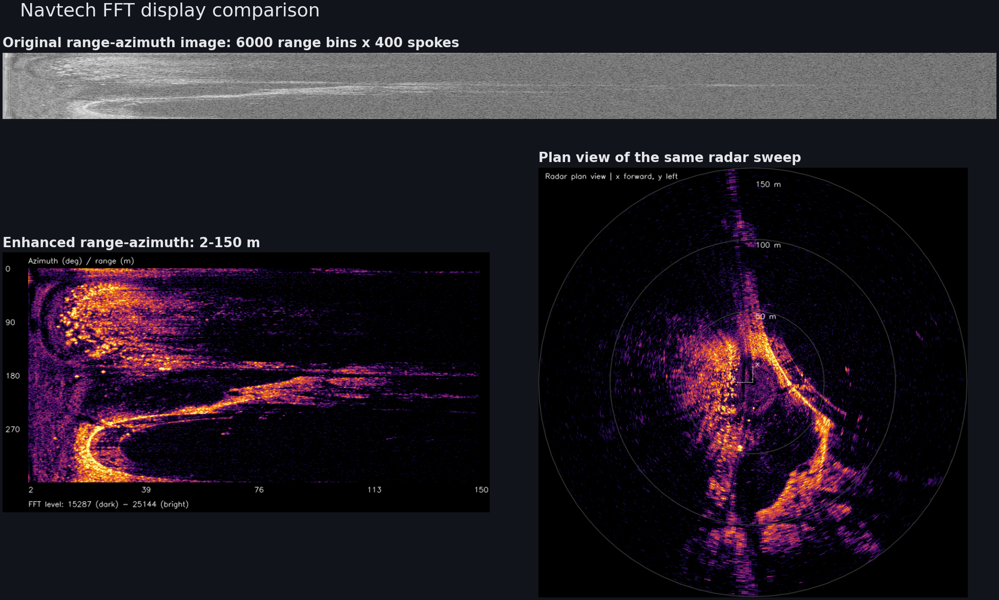

# Navtech Radar ROS 2

Lossless ROS 2 support for Navtech rotating radar, initially targeting the
CTS350-X and the 16-bit high-precision FFT stream used by The Great Outdoors
Dataset.

## Standalone playback on ROS 2 Lyrical

The C++ adapter and sweep assembler process the CTS350-X's 16-bit FFT stream.
They produce raw spokes, sweeps and images, with optional adaptive peak selection,
planar point clouds and laser scans. The C++ visualizer renders the polar and
Cartesian displays with OpenCV and uses TF for timestamped vehicle headings.
Live radar transport is still planned.

This checkout contains all four ROS packages, including the legacy `nav_ross`
interfaces. Start with a ROS 2 Lyrical installation, colcon, a C++17 compiler,
and an initialized rosdep. Run the following in an empty workspace.

```bash
source /opt/ros/lyrical/setup.bash
mkdir -p src
git clone --branch cpp https://github.com/jcfurey/navtech_radar_ros2.git src/navtech_radar_ros2
sudo apt-get install python3-rosbags
rosdep install --from-paths src --ignore-src --rosdistro lyrical -r -y
colcon build --cmake-args -DCMAKE_BUILD_TYPE=Release -DBUILD_TESTING=ON
source install/setup.bash
colcon test --return-code-on-test-failure
colcon test-result --verbose
```

Set `bag` to the converted ROS 2 MCAP directory containing `metadata.yaml`.
The launch plays only the two radar topics and recorded TF, publishes a clock,
and starts a radar-frame RViz profile when requested.

```bash
ros2 launch navtech_radar_processing playback.launch.py bag:=/path/to/ros2_mcap rviz:=true
```

Use `recording:=` for Navtech COLRAW, the Thames CPR with its decoded companion, vendor ROS 1 and ROS 2 sensor products, and the Oxford, RADIATE, Boreas, MulRan and MUSES radar datasets.

```bash
ros2 launch navtech_radar_processing playback.launch.py recording:=/path/to/radiate/tiny_foggy rviz:=true
```

For the input path and playback options for each collection, see the [recording playback guide](docs/recording-playback.md).

Omit both `bag` and `recording` for an external TAMU player. Options include `cloud`, `scan`,
`peak_selection`, `scan_selection`, `rate`, and `implementation:=python`
for the reference nodes. `frame_id` sets the adapter radar frame and the RViz
fixed frame (default `navtech`). `robot_frame` and `heading_frame` enable the optional TF overlays
when the corresponding transforms are available. Robot-specific mounting and
the full TAMU viewer belong to the surrounding TAMU workspace.

The radar model, recorded geometry and manufacturer datasheet are in the
[hardware reference](docs/cts350x.md). The [product and recording inventory](docs/radar-products-and-recordings.md)
links Navtech's radar families to public sensor captures and identifies the formats available for playback and export comparisons.
Credit for the SDK, dataset, legacy
interfaces and related projects is in [Sources and acknowledgments](THIRD_PARTY.md).
Navtech lists this implementation in its [published works directory](https://navtechradar.atlassian.net/wiki/spaces/IA/pages/2408480879/Published+works+including+Navtech+Radar).

## Bag playback

`navtech_radar_driver/legacy_bag_driver` adapts the dataset's ROS 1-derived
topics without changing the source bag:

```text
/Navtech/Configuration_Topic -> /navtech_radar/configuration
/Navtech/FFTData             -> /navtech_radar/fft/spoke
```

`navtech_radar_processing/fft_sweep_assembler` then publishes:

```text
/navtech_radar/fft/sweep     navtech_radar_msgs/FftSweep
/navtech_radar/fft/image     sensor_msgs/Image (mono16)
/navtech_radar/point_cloud   sensor_msgs/PointCloud2 (optional, lossy)
/navtech_radar/scan          sensor_msgs/LaserScan (optional, lossy)
```

The installed executables `legacy_bag_driver`, `fft_sweep_assembler` and
`fft_sweep_visualizer` are C++. Each has a Python reference executable with the
suffix `_py`. For TAMU bags, `implementation:=python` selects all three
references. Both implementations accept the same ROS parameters and topic remaps.

For faster playback, `implementation:=cpp_composed` loads the three C++ nodes
into one three-thread ROS component container. It passes spokes and sweeps
between the nodes in memory. External subscribers can read the same topics.

```bash
ros2 launch navtech_radar_processing playback.launch.py implementation:=cpp_composed bag:=/path/to/ros2_mcap
```

## Enhanced images

`navtech_radar_processing/fft_sweep_visualizer` optionally consumes the sweep
and its configuration and publishes two `bgr8` display images:

- `navtech_radar/fft/display`: cropped, labeled range–azimuth image.
- `navtech_radar/fft/cartesian`: top-down radar image with range rings, bearing
  ticks, +x up and +y left. Both images show coverage, missing/duplicate bearings,
  frame name and scan rate. TF supplies a cyan vehicle-forward marker and vehicle
  yaw in the requested reference frame at the sweep's acquisition timestamp.
  A missing transform or zero acquisition timestamp gives an unavailable heading.

Set `robot_frame` and `heading_frame` to enable the TF overlays; the TAMU launch
sets `lester/base` and `lester/map`. Yaw is counterclockwise around reference +z
from reference +x, not a geographic compass heading. TF is used for annotations;
image pixels stay in the radar frame. The full mounting rotation is respected
when projecting the vehicle's forward axis into that frame.

The default display range is 2–150 m. Range columns are reduced to at most
1000 using maximum pooling, preserving narrow peaks. Encoder values place rows
on the configured azimuth grid; duplicate rows combine by maximum for display,
and missing rows remain black. Smoothed 50th/99.7th percentile contrast and an
Inferno color scale make returns easier to see than full-range linear grayscale.
The color scale shows raw FFT levels, not calibrated power or height. Contrast
history resets when configuration changes or timestamps move backward.

These are lossy visualization products. `FftSweep`, `FftSpoke`, and the original
`mono16` image are unmodified. Spoke-local detections have zero measured elevation. The visualizer requires a matching nonzero
configuration version and supports up to 2048 azimuth rows and 16384 range bins.
Image publishers and the sweep subscription use reliable, volatile QoS, depth 1.
The native visualizer renders each view only when that view has subscribers.

```bash
ros2 run navtech_radar_processing fft_sweep_visualizer --ros-args \
  -p use_sim_time:=true -p max_range:=100.0 -p lower_percentile:=60.0
```

Other startup parameters include `min_range`, `image_width`, `cartesian_size`
(800 by default), `upper_percentile`, `contrast_alpha` (0.2), `gamma` (1.0),
and `annotate` (true). Gamma below 1 brightens weaker returns. The playback
workspace starts this node and configures RViz automatically. Its
`radar_images:=false` launch option returns to the raw image display.

On the TAMU installation, the native encoder advances clockwise as viewed from
above. With ROS +x up and +y left, a native 90° return appears on the right at
zero yaw offset. Both displays, the point cloud and the scan use the same
bearing, `azimuth_offset_degrees − native_angle_degrees`. The polar image keeps
the encoder rows in order and labels them with their ROS bearings. The sign was
checked against a nearly stationary vehicle turn. [Recorded turn validation](docs/playback_validation.md#bearing-and-range-validation)



Updated recorded-data previews: [plan view with heading](docs/radar_heading_plan.png)
and [range–azimuth view](docs/radar_heading_polar.png).

## Planar detections and scans

The assembler can publish both multiple detections per spoke as `PointCloud2`
and one detection per bearing as `LaserScan`. Enable `publish_point_cloud` and/or
`publish_scan`. Both use the input radar frame and raw FFT intensity units. Each spoke measures
range and azimuth in its local z=0 plane.

For mapping on a moving vehicle, set `deskew_fixed_frame` to a continuous
odometry frame. Each cloud point is transformed from the radar pose at its
spoke timestamp to the radar pose at the first spoke timestamp, using full 3D
translation and rotation. The cloud header names that radar frame and time.
Pitch, roll or vertical motion can therefore contribute to the corrected z
coordinate. The scan retains the measured range and bearing at acquisition.
[tf2 two-time transform API](https://github.com/ros2/geometry2/blob/rolling/tf2_ros_py/tf2_ros/buffer.py)

The TAMU viewer can set `lester/odom` automatically when the cloud is enabled.
The launch integration is available for external workspace checkouts.
[TAMU viewer patch](docs/tamu_cloud_deskew.patch)

For standalone playback with the TAMU mount TF available, run

```bash
ros2 launch navtech_radar_processing playback.launch.py bag:=/path/to/ros2_mcap \
  frame_id:=lester/navtech deskew_fixed_frame:=lester/odom
```

Standalone playback defaults to an empty `deskew_fixed_frame` and publishes
cloud points at their individual measurement poses. With compensation enabled,
a cloud requires a positive first timestamp and TF for every spoke contributing
points. The assembler holds one completed cloud for late TF and retries for up
to one wall-clock second or until the next cloud supersedes it. If coverage is
still incomplete, it drops that cloud. Raw sweeps and scans continue during TF
outages. A moving reflector can still change position during the revolution.

`peak_selection=threshold` preserves the original local-maxima threshold mode.
The TAMU launch defaults to `cfar`: cell-averaging background estimation with
16 training cells and 4 guard cells **per side**, an additive threshold offset
of 3000 raw FFT units, and the existing 22000 minimum intensity. Complete
training windows are required. Maxima closer than `min_peak_separation` (0.5 m)
are reduced to the strongest, with ties preferring nearer bins. These are
empirical settings for this 16-bit recording; additive raw-level filtering
does not imply a calibrated false-alarm probability. Clutter boundaries can
still produce detections.

Clouds retain the strongest `max_points_per_spoke` peaks (0 means all), in range
order. `scan_selection=nearest` chooses the nearest filtered peak before that
cloud budget is applied; `strongest` instead chooses the largest FFT level.
Thus a scan is useful for a compact planar view, while the cloud retains
multiple reflectors along a bearing. The source-bin checks cover both filters and the manufacturer’s two recorded cloud formats. [Filtered cloud validation](docs/playback_validation.md#filtered-point-cloud-validation)

The scan keeps clockwise acquisition order. For `N` bearings,
`angle_increment = −2π/N`, `angle_min` is the first acquired bearing in [0, 2π),
and `angle_max = angle_min + (N−1) × angle_increment`. The header carries the
first spoke's sensor timestamp. Consumers must support a negative angular
increment. Missing bearings and observed bearings with no accepted detection
both carry `NaN` with zero intensity. Use the sweep's encoder list to distinguish
the two cases. A missing peak leaves occupancy unknown. Off-grid rays farther
than a quarter of a cell are omitted. Duplicate bearings use the configured
nearest/strongest policy. [ROS LaserScan message](https://docs.ros.org/en/lyrical/p/sensor_msgs/msg/LaserScan.html)

Range gates, peak separation, scan ranges, cloud positions and display scales
use the configured metric axis. For zero-based bin `i`, the range in metres is
`i × range_resolution × range_gain + range_offset`. The TAMU recording omits
the calibration coefficients, so its adapter supplies gain 1 and offset 0.
Older canonical configurations with both fields zero also use this identity.
`FftSweep.range_resolution` carries the nominal spacing. [Navtech Colossus configuration](https://navtechradar.atlassian.net/wiki/spaces/IA/pages/2061009217)

`scan_time` comes from the configured rotation period. `time_increment` is
nonzero only when per-spoke timestamps agree with that uniform acquisition
schedule within 10% of a cell period (at least 1 µs), without duplicates or
off-grid rays. Otherwise it is 0, representing a snapshot. The finite ranges describe the selected radar reflections.

```bash
ros2 launch navtech_radar_processing playback.launch.py bag:=/path/to/ros2_mcap rviz:=true
ros2 launch navtech_radar_processing playback.launch.py bag:=/path/to/ros2_mcap scan_selection:=strongest
ros2 launch navtech_radar_processing playback.launch.py bag:=/path/to/ros2_mcap peak_selection:=threshold
```

Other extraction parameters are `cfar_training_cells`, `cfar_guard_cells`,
`cfar_threshold_offset` and `min_peak_separation`; the TAMU launch prefixes
these with `radar_`. Set a suitable intensity floor and CFAR offset for other
sample depths or recordings. Scan/cloud publishers use sensor-data QoS and
publish empty/all-no-detection results to clear previous sweeps.

## Runtime behavior

Canonical topic defaults are relative (`navtech_radar/configuration`,
`navtech_radar/fft/spoke`, etc.). At the root namespace they retain the names
shown above. In namespace `/robot`, they become `/robot/navtech_radar/...`.
Diagnostics use the relative `diagnostics` topic. This follows ROS 2's
[relative topic name semantics](https://design.ros2.org/articles/topic_and_service_names.html#namespaces).
The two legacy input defaults remain absolute to match existing bags; override
the input topic parameters or use ROS remapping for other sources.

Configuration uses reliable, transient-local QoS, depth 1. Spokes use
best-effort, volatile QoS with a configurable bounded queue. Sweep and image
outputs use reliable, volatile QoS, depth 2; optional point clouds use the
sensor-data profile. "Lossless" describes the sample representation, not a
guarantee of packet delivery over best-effort DDS.

The adapter rejects malformed payload sizes, invalid timestamps and invalid
configuration geometry. A spoke before the first configuration has version 0.
The legacy seconds/nanoseconds are preserved; the bag cannot recover original
wire timestamp bytes. Diagnostic timers use steady time so they continue to
report stale input while `/clock` is absent or paused.

The assembler preserves the incoming frame. `output_frame` defaults to empty;
if set, it requires that same input frame. It does not transform coordinates.
Use TF for mounting transforms. The optional `azimuth_offset_degrees` adjusts
derived scan/cloud bearings, not the canonical FFT data. Give the visualizer
the same value to keep its Cartesian view aligned.

The TAMU workspace's provisional mount uses `radar_mount_roll=0.0` so the
radar's +y axis remains leftward in the robot frame. A roll of approximately π
around +x reverses +y and +z, horizontally mirroring a planar cloud/scan even
when the radar-frame images look correct. The earlier LWLRF-derived 3.14 rad
roll was removed following that observed mismatch. Translation and yaw remain
provisional; a physical calibration should replace the placeholder transform.
The workspace correction is preserved in [docs/tamu_planar_mount.patch](docs/tamu_planar_mount.patch)
because the surrounding TAMU playback workspace is not part of this repository.
Apply that patch from a workspace root still using the old roll, then rebuild
`lester_description` and `tamu_bag_viz` and restart playback. It updates both
the static TF launch default and the robot model's matching joint default.

Sweeps never mix configuration versions, range-bin counts, sample depths, or
frames. Configuration changes finish the preceding sweep with its original
geometry. Nonzero versions are accepted only after their configuration arrives;
unmatched spokes are rejected with a warning rather than assigned guessed
geometry. Version 0 uses `range_resolution` and `expected_spokes` as fallback
values until a configuration arrives. Invalid configurations leave the last
valid configuration active.

Rows are stably sorted by encoder count and duplicates remain separate rows.
`publish_partial_sweeps` defaults to true, subject to `minimum_spokes` (2).
When false, each nominal angular cell must contain exactly one spoke, and each
ray must also fit its first-spoke-relative scan cell within a quarter cell.
With a configuration, the supplied angle must agree with the encoder bearing
within half an encoder tick across the 0° wrap. Derived products then use the
encoder bearing. Before configuration, the assembler uses the supplied angle
and requires distinct raw encoder counts for a complete sweep.

A large backwards angle step closes a revolution. Packet loss around encoder
zero can leave a smaller step. With a configuration, the assembler also checks
whether the 16-bit FFT packet counter advanced by the number of angular cells
for one crossing of zero (within half a cell). When the rotation rate and both
sensor timestamps are available, the elapsed time must also support that crossing.
This allows the two partial sweeps to be published separately or evaluated
individually in strict mode. The counter wraps at 65,536. [Navtech FFT packet format](https://navtechradar.atlassian.net/wiki/spaces/IA/pages/2061009217)

A forward gap of at least one configured revolution starts a new sweep. Backward
sensor time also starts a new sweep, with one exception observed in the TAMU
recording. Within a turn, a single timestamp can fall between the two preceding
positive timestamps by stepping back less than one nominal spoke interval. The
assembler retains it when the packet counter advances by one and the encoder
advances by one angular cell within a half-cell tolerance. The raw timestamps
preserve the inversion and the scan reports irregular timing. When rotation rate
is unknown, backward time resets assembly and the forward-gap limit is
`fallback_max_spoke_gap_sec` (default 1.0 s). A subsequent wrap or geometry
change closes the pending final sweep.

`max_buffered_spokes` (2048) and `max_range_bins` (16384) bound retained raw data
to at most 64 MiB with the defaults, excluding DDS queues and output buffers.
Oversized spokes/configurations are rejected. Reaching the spoke limit without
a wrap discards the pending sweep and starts again. Increase the limits at
startup for larger supported scans. Empty point clouds are published when an
accepted sweep has no selected peaks, allowing viewers to clear stale points.

All application parameters are validated at startup and read-only afterward;
`use_sim_time` retains the standard ROS behavior. Restart the node to change
processing settings. ROS topic remapping and parameter overrides still apply
at startup.

## Performance and verification

On 32 full revolutions of the April 2024 TAMU recording, the C++ adapter and
assembler together used 4.16 s of CPU versus 11.20 s for the Python nodes in
one Release-build run. Both pipelines had subscribers for the raw sweep,
raw image, CFAR cloud and nearest-return scan. The comparison checks every raw
image row, sweep metadata, scan fields, and cloud geometry and intensities.
The benchmark preloads the same input spokes and waits for each revolution's
outputs. Reader, viewer and comparison-process CPU are outside these figures.
See the [measurement details](docs/playback_validation.md#native-playback-comparison).

In a separate comparison on the same 32 revolutions, the visualizer alone used
1.49 s of CPU in C++ and 2.51 s in Python. Both annotated BGR8 views matched
byte-for-byte. [Image comparison details](docs/playback_validation.md#native-image-comparison)

Run either comparison on Linux from a sourced build.

```bash
ROS_DOMAIN_ID=91 ROS_AUTOMATIC_DISCOVERY_RANGE=LOCALHOST \
  python3 src/navtech_radar_ros2/tools/compare_playback.py /path/to/ros2_mcap --rotations 32
ROS_DOMAIN_ID=91 ROS_AUTOMATIC_DISCOVERY_RANGE=LOCALHOST \
  python3 src/navtech_radar_ros2/tools/compare_images.py /path/to/ros2_mcap --rotations 32
```

The paced stress test measures throughput and latency with all six products
subscribed. It checks every raw row while the feeder continues at the requested
rate. For the independent export check, add `--check-exports` to
`compare_playback.py` on complete recorded turns. [Results and reproduction commands](docs/playback_validation.md#paced-load-and-export-accuracy)

The registered tests also exercise both installed implementations with a small
deterministic fixture. They run without a bag or radar hardware.

## SDK submodule

The canonical Navtech IASDK is pinned at `vendor/iasdk-public` as a Git
submodule, currently at commit `62759ba2f60bcef6e3787d889aba6b0773dde647`:

```bash
git submodule update --init --recursive
```

The SDK is independently MIT licensed by Navtech Radar Ltd. See
`vendor/iasdk-public/LICENSE.txt` after initializing the submodule and
[THIRD_PARTY.md](THIRD_PARTY.md).

The `vendor/COLCON_IGNORE` marker prevents colcon from discovering the SDK's
bundled ROS examples as workspace packages. Our driver will consume only the
needed C++17 Colossus protocol and transport targets.

### Upstream checkout note

The pinned upstream commit has a line-ending defect in
`cpp/cpp_17/.gitattributes`: three prebuilt Windows `.lib` files and two CMake
files appear modified immediately after a clean Linux checkout. The submodule
is treated as read-only, and `.gitmodules` suppresses that known false-positive
in the parent repository. Inspect its actual state explicitly when needed:

```bash
git -C vendor/iasdk-public status --short
```

Any SDK change should be made in a reachable fork/commit and then update the
gitlink; local uncommitted SDK patches must not become driver dependencies.

## Repository layout

```text
navtech_radar_ros2/
├── nav_ross/                   # legacy bag-compatible IDL
├── docs/
├── navtech_radar_driver/       # transport nodes and legacy bag adapter
├── navtech_radar_msgs/         # configuration, spoke, and sweep interfaces
├── navtech_radar_processing/   # optional sweep/projection/CFAR components
└── vendor/
    └── iasdk-public/           # pinned upstream submodule
```
